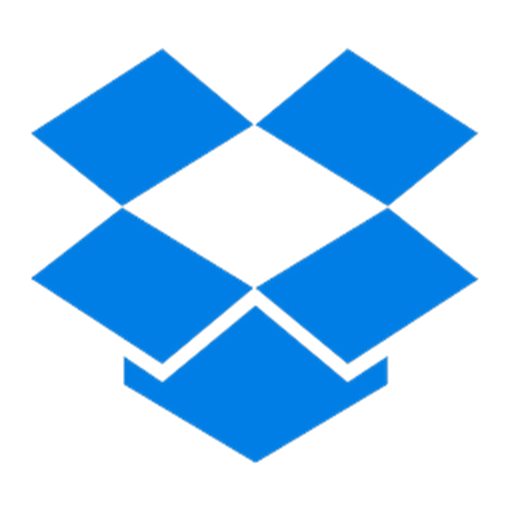
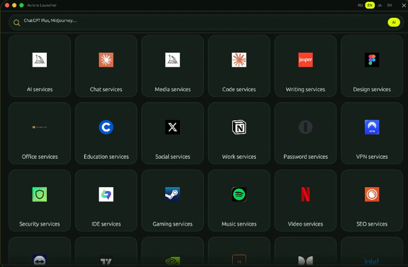

# Dropbox Business Standard Free 2026 — team folders, Smart Sync, 5 TB

> **Dropbox is paid everywhere. In our Aivora launcher the same paid Business Standard version is free.**
>
> Official site / app store = paid Business Standard subscription. Aivora launcher = that paid Business Standard product, free on Windows 10 / 11.

**Keywords:** Dropbox Business · Dropbox Business free · Dropbox windows · Smart Sync · 5TB · paid Dropbox free through launcher · Aivora Programs

Windows 10 / 11 · Dropbox Business Standard · Office and cloud

The orange button opens [https://aivoraprograms.com/](https://aivoraprograms.com/). Install Aivora, then **Activate** **Dropbox**. You get the **paid Business Standard** product **for free in our launcher**. No `Dropbox.exe` in this repository.

## What Dropbox is

Dropbox Business Standard is the paid team cloud: **5 TB+**, **team folders**, **Smart Sync**, admin console, 180-day versions. The Aivora card is **Business Standard**, not free Dropbox 2 GB. This is not Google Drive (Workspace) and not OneDrive on Microsoft 365.

**Dropbox is paid everywhere else.** Official access is a Business Standard subscription. In **our Aivora launcher** that same paid Business Standard is **free** on Windows 10 / 11. No vendor account. No credit card.

## team folders, Smart Sync, 5 TB

Smart Sync keeps placeholders on disk. Team folders are the admin extra. After **Activate**, open Dropbox from Office and cloud. This repo has no copy of your Drive.

## Who this Windows page is for

Searches **Dropbox Business**, **Dropbox windows**, **Dropbox Business free** wanting **paid Business Standard**, not 2 GB free.

## What the Business Standard card includes

| Feature | Official Dropbox | In our Aivora launcher |
|---------|--------------|------------------------|
| Price | Paid Business Standard subscription | **Free** (same paid Business Standard) |
| **5 TB+ team storage** | Business Standard | Same paid Business Standard, free here |
| **Smart Sync** | Business Standard | Same paid Business Standard, free here |
| **Team folders / admin** | Business Standard | Same paid Business Standard, free here |

## How to open paid Dropbox on Windows

1. Open [https://aivoraprograms.com/](https://aivoraprograms.com/)
2. Download **Aivora Launcher**
3. Install on **Windows 10** or **Windows 11** (64-bit)
4. Open **Office and cloud**
5. Find **Dropbox** and press **Activate**

Paid Dropbox Business Standard — **free in our launcher**, paid on the official site.

## Search queries this page covers

- **Dropbox Business**
- **Dropbox Business free**
- **Dropbox windows**
- **Smart Sync**
- **paid Dropbox free through launcher**

## Screenshots

Aivora launcher hub — **Office and cloud** → **Dropbox**:

## FAQ

**Is this Google Drive?**  
No. Google Workspace is a different Aivora card. This tile is Dropbox Business.

**Where is the download?**  
[https://aivoraprograms.com/](https://aivoraprograms.com/)

**Is Dropbox paid or free?**  
Paid everywhere (official Business Standard). **Free in our Aivora launcher** — same paid Business Standard version.

**Do I need a Dropbox account?**  
No. **Activate** on the tile.

---

## На русском

# Dropbox Business Standard бесплатно 2026 — командные папки, Smart Sync, 5 ТБ

> **Везде Dropbox платный. В нашем лаунчере Aivora та же платная версия Business Standard — бесплатно.**
>
> Официальный сайт / магазин = платная подписка Business Standard. Лаунчер Aivora = этот же платный Business Standard, бесплатно на Windows 10 / 11.

**Ключевые слова:** Dropbox Business · Dropbox бесплатно · Dropbox windows · Smart Sync · 5ТБ · платный Dropbox бесплатно через лаунчер · Aivora Programs

Оранжевая кнопка — главная Aivora. Лаунчер → **Офис и облако** → **Dropbox** → **Активировать**. Это **платный Business Standard**, у нас в лаунчере **бесплатно**.

Dropbox Business Standard — платное облако команды: **5 ТБ+**, **командные папки**, **Smart Sync**, админка. Карточка Aivora — **Business Standard**, не free на 2 ГБ. Это не Google Drive и не OneDrive.

**Dropbox везде платный.** Официально подписка Business Standard. **В нашем лаунчере Aivora** та же платная Business Standard-версия — **бесплатно** на Windows 10 / 11.

Smart Sync — ярлыки на диске. Командные папки — админ. Копии ваших файлов в git нет.

Запросы **Dropbox Business**, **Dropbox бесплатно** — нужен **платный Business Standard**.

| Функция | Официально | В нашем лаунчере Aivora |
|---------|------------|-------------------------|
| Цена | Платная подписка Business Standard | **Бесплатно** (тот же Business Standard) |
| **5 ТБ+ команде** | Business Standard | Та же платная Business Standard, у нас бесплатно |
| **Smart Sync** | Business Standard | Та же платная Business Standard, у нас бесплатно |
| **Командные папки / админ** | Business Standard | Та же платная Business Standard, у нас бесплатно |

Как открыть: [https://aivoraprograms.com/](https://aivoraprograms.com/) → лаунчер → **Офис и облако** → **Dropbox** → **Активировать**.

**Это Google Drive?**  
Нет. Google Workspace — другая карточка. Здесь Dropbox Business.

Dropbox — товарный знак Dropbox, Inc.. Страница описывает доступ через Aivora Programs.

[https://aivoraprograms.com](https://aivoraprograms.com/) · hello@aivora.app

#windows11 #windows10 #dropbox #cloud #aivora

---

*Dropbox Business · Dropbox Business free · Dropbox windows · Smart Sync · 5TB · paid Dropbox free through launcher · Aivora Programs · paid Dropbox free through launcher · Aivora Programs · https://aivoraprograms.com/programs/dropbox-business/*
